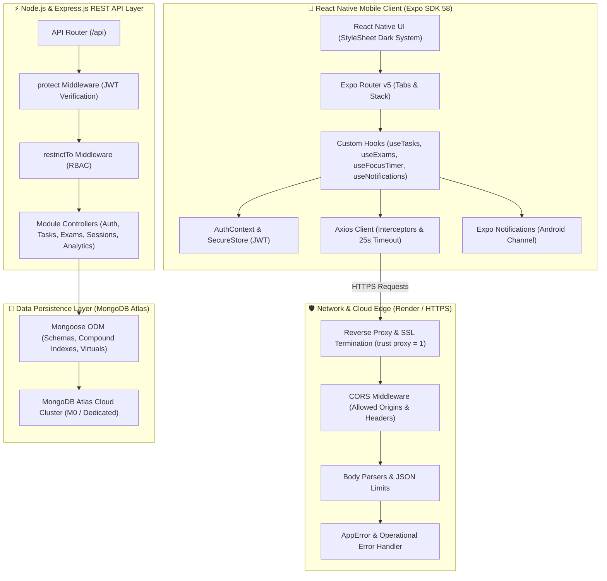

# 🎓 StudyMate – Smart Study Planner

> **"Plan Smart. Study Better. Achieve More."**  
> *A full-stack, enterprise-grade mobile application and cloud backend designed for modern college students to master study routines, conquer exam schedules, maximize focus, and eliminate academic anxiety.*

[](https://www.typescriptlang.org/)
[](https://expo.dev/)
[](https://nodejs.org/)
[](https://www.mongodb.com/atlas)

---

## 📑 Table of Contents
1. [Project Overview & Value Proposition](#-project-overview--value-proposition)
2. [Key Feature Modules](#-key-feature-modules)
3. [System Architecture & Data Flows](#-system-architecture--data-flows)
4. [Technology Stack](#-technology-stack)
5. [Prerequisites & Local Installation](#-prerequisites--local-installation)
6. [Environment Configuration](#-environment-configuration)
7. [Comprehensive REST API Documentation](#-comprehensive-rest-api-documentation)
8. [Production Deployment Guide](#-production-deployment-guide)
   - [Part A: Render Cloud Deployment (Backend)](#part-a-render-cloud-deployment-backend)
   - [Part B: MongoDB Atlas Production Security](#part-b-mongodb-atlas-production-security)
   - [Part C: Expo Mobile Client Production Configuration](#part-c-expo-mobile-client-production-configuration)
   - [Part D: Live Endpoint Verification](#part-d-live-endpoint-verification)
9. [Deployment Matrix: Automated vs User Authorization Required](#-deployment-matrix-automated-vs-user-authorization-required)
10. [Folder Architecture](#-folder-architecture)
11. [Testing, QA & Code Quality](#-testing-qa--code-quality)
12. [Mobile UI Walkthrough & Screens](#-mobile-ui-walkthrough--screens)
13. [Security & Production Hardening](#-security--production-hardening)
14. [License & Acknowledgments](#-license--acknowledgments)

---

## 🌟 Project Overview & Value Proposition

College students routinely juggle overlapping semester exams, assignment deadlines, lecture timetables, and self-study targets across multiple courses. Existing generic to-do list applications fail because they treat all deadlines equally, omit syllabus topic mastery tracking, and do not provide continuous wall-clock synchronized focus engines.

**StudyMate** is purpose-built to solve these challenges with an integrated mobile experience:
- **Intelligent Daily Dashboard**: Aggregates urgent tasks, upcoming exams, streak statistics, and weekly study hour trends into a single glance.
- **Syllabus-Aware Exam Countdown**: Tracks exams by countdown urgency tiers (e.g. *Today*, *Tomorrow*, *≤3 days*), recording topic completion percentages and target grade scores.
- **Pomodoro Focus Engine**: Features wall-clock background synchronization (resilient to mobile lock-screens and app switching) and automatic study streak tracking with duplicate session safeguards.
- **Weekly Schedule Conflict Detection**: Validates timetable slots before saving to prevent double-booking study sessions.
- **In-App & Device Notifications**: Schedules Android system reminders for upcoming exams and deadlines using high-importance notification channels.
- **Multi-Tenant Cloud Backend**: Enforces strict user isolation across all CRUD APIs with zero cross-tenant data leakage.
---

## 🧩 Key Feature Modules

### 1. 🔐 Secure Authentication & Session Management
- **Registration & Login**: Secure credential exchange with email format validation and password minimum length enforcement.
- **Cryptographic Protection**: Passwords salted and hashed with **bcryptjs** (10 salt rounds); plaintext passwords never stored or logged.
- **Stateless Authorization**: Signed **JSON Web Tokens (JWT)** with 7-day expiration.
- **Hardware-Backed Storage**: Tokens cached in memory and safely stored on Android via `expo-secure-store`.
- **Automatic 401 Interceptors**: Centralized Axios response interceptors immediately log out expired sessions and redirect to auth.

### 2. 🏠 Personalized Student Dashboard
- **Real-Time Greeting & Streak Highlight**: Live study streak fire counter and motivational greeting.
- **Today's Action Feed**: Displays high-priority tasks and study plans scheduled for today.
- **Urgent Exam Countdown Banner**: Highlights the closest upcoming exam with dynamic badge colors.
- **Weekly Activity Chart**: Responsive 7-day bar chart showing daily study minutes logged.
- **Quick Action Grid**: One-tap shortcuts to start a Pomodoro session, add a task, view timetable, or check analytics.

### 3. 📖 Intelligent Study Planner
- **Multi-Attribute Plans**: Organize study slots by subject, topic, date, start time, duration, and priority.
- **Filtering & Search**: Dynamic horizontal subject chips, date tabs, status toggles, and safe regex text search.
- **Status Toggling**: Smooth transition between pending and completed states.

### 4. ✅ Smart Task Management
- **Eisenhower Priority System**: Categorize tasks as `urgent`, `high`, `medium`, or `low`.
- **Automatic Overdue Detection**: Identifies overdue tasks in red with warning alerts.
- **Auto-Sync Timestamps**: Automatically sets `completedAt` timestamp upon completion toggle.
- **Multi-Filter Chips**: Filter by Status (`all`, `pending`, `completed`), Priority, and Subject.

### 5. 📅 Weekly Timetable & Calendar
- **Monday–Sunday View**: Horizontally scrollable day strip with active day highlights.
- **Slot Overlap Validation**: Server-side algorithm detects and rejects overlapping time slots on the same day for a user.
- **Color-Coded Subject Chips**: Visual distinction between subjects across weekly lectures and self-study blocks.

### 6. 🎯 Exam Countdown Tracker
- **Dynamic Urgency Alerts**: Visual alerts for exams occurring *Today!*, *Tomorrow*, or *Within 3 Days*.
- **Syllabus Checklist**: Interactive topic list allowing students to mark individual chapters as covered, calculating real-time syllabus coverage percentages.
- **Target Score Tracking**: Records target grades and percentage goals.

### 7. ⏱️ Focus Timer & Pomodoro Engine
- **Standardized Intervals**: 25-minute Focus, 5-minute Short Break, 15-minute Long Break, plus custom Stopwatch mode.
- **Wall-Clock Background Restoration**: Listens to React Native `AppState` changes to accurately subtract background wall-clock time upon resuming.
- **Idempotent Session Logging**: Uses unique `clientSessionId` and time-window deduplication to prevent double-logging study sessions.
- **Study Streak Auto-Increment**: Automatically increments consecutive day streaks upon logging study sessions.

### 8. 📊 Productivity Analytics & Insights
- **Flexible Time Ranges**: Filter analytics by `7d` (Week), `30d` (Month), or `all` (Quarter).
- **Subject Distribution**: Aggregates time spent per subject with percentage breakdown and star ratings.
- **Task Completion Metrics**: Computes completion velocity, pending tasks, and overdue ratios.
- **Composite Productivity Score**: Evaluates performance on a 0–100 scale based on study targets, task completion rate, and rating averages.

### 9. 👤 User Profile & Settings
- **Profile Customization**: Update name, bio, institution, and choose from 8 curated student avatars or custom URLs.
- **Security Settings**: Secure password updates requiring current password verification.
- **Study Goals**: Configure weekly study targets (e.g. 20 hours) and daily focus presets.
- **Cascade Account Deletion**: Irreversible deletion workflow requiring explicit password and `"DELETE"` confirmation, cascading cleanup across all collections.

### 10. 🔔 In-App Notifications & Reminders
- **Notification Center**: In-app notification tray with unread counter badges and category filters (`all`, `exams`, `tasks`, `streak`).
- **Auto-Reminder Engine**: Backend scanner identifies exams within 3 days and tasks due today to generate duplicate-safe reminders via `dedupKey`.
- **Android System Channel**: Native Expo Notifications integration configured with channel ID `studymate-reminders` (high importance, vibration pattern, purple LED).

---

## 🏗️ System Architecture & Data Flows



---

## 💻 Technology Stack

| Domain | Technology / Library | Version | Purpose |
|---|---|---|---|
| **Frontend Framework** | React Native | 0.76.7 | Native mobile cross-platform framework |
| **Mobile Toolchain** | Expo SDK | 58.0.0 | Toolchain, runtime & build system |
| **App Routing** | Expo Router | v5 | File-based declarative mobile navigation |
| **Language** | TypeScript | ^5.3.3 | End-to-end static type safety |
| **HTTP Client** | Axios | ^1.7.9 | Network requests, token injection, error interceptors |
| **Secure Storage** | `expo-secure-store` | SDK 58 | Encrypted device keychain/keystore persistence |
| **Local Notifications** | `expo-notifications` | SDK 58 | Android notification channel & local scheduled alerts |
| **Icons** | `lucide-react-native` | ^0.475.0 | Crisp, modern feather-style iconography |
| **Backend Runtime** | Node.js | v22 / v20 LTS | High-performance asynchronous JavaScript runtime |
| **Backend Framework** | Express.js | ^4.21.2 | Modular REST API routing & middleware |
| **Database** | MongoDB Atlas | 8.0+ | Fully managed cloud NoSQL document database |
| **ODM** | Mongoose | ^8.9.5 | Schemas, compound indexes, hooks, and virtuals |
| **Authentication** | `jsonwebtoken` | ^9.0.2 | Signed stateless Bearer tokens |
| **Hashing** | `bcryptjs` | ^2.4.3 | Salted one-way password hashing (10 rounds) |
| **CORS** | `cors` | ^2.8.5 | Cross-Origin Resource Sharing control |
| **Code Quality** | ESLint | ^9.20.0 | Expo flat configuration (`eslint.config.js`) |
| **Cloud Hosting** | Render | PaaS | Web Service hosting with automated CI/CD Blueprints |

---

## 🛠️ Prerequisites & Local Installation

### Prerequisites
- **Node.js**: `v18.0.0` or higher (recommended: `v20.x` or `v22.x`)
- **npm**: `v9.0.0` or higher
- **Git**: `v2.x`
- **Expo Go App**: Installed on physical Android device ([Google Play Store](https://play.google.com/store/apps/details?id=host.exp.exponent))
- **MongoDB Atlas Account**: Free Tier (M0) cluster ([mongodb.com](https://www.mongodb.com/cloud/atlas))

---

### Step 1: Clone the Repository
```bash
git clone https://github.com/ghorikahan/Study_mate.git
cd Study_mate
```

---

### Step 2: Backend Setup
1. Navigate to the backend directory:
   ```bash
   cd backend
   ```
2. Install dependencies:
   ```bash
   npm install
   ```
3. Create your local environment configuration:
   ```bash
   # On Windows PowerShell:
   Copy-Item .env.example .env

   # On Linux / macOS:
   cp .env.example .env
   ```
4. Edit `backend/.env` with your settings:
   ```env
   PORT=5000
   NODE_ENV=development
   MONGODB_URI=mongodb+srv://<username>:<password>@cluster0.xxxxx.mongodb.net/studymate?retryWrites=true&w=majority
   JWT_SECRET=super_secret_local_dev_key_studymate_2026
   JWT_EXPIRES_IN=7d
   CORS_ORIGIN=*
   ```
5. Run the local backend development server:
   ```bash
   npm run dev
   ```
   *The server starts on `http://localhost:5000`.*

---

### Step 3: Frontend Setup
1. Open a new terminal and navigate to the frontend directory:
   ```bash
   cd frontend
   ```
2. Install dependencies:
   ```bash
   npm install
   ```
3. Create your frontend environment configuration:
   ```bash
   # On Windows PowerShell:
   Copy-Item .env.example .env

   # On Linux / macOS:
   cp .env.example .env
   ```
4. Set the `EXPO_PUBLIC_API_URL` variable in `frontend/.env`:
   - **For Physical Android Phone on same Wi-Fi**: Set your computer's local Wi-Fi IPv4 address:
     ```env
     EXPO_PUBLIC_API_URL=http://192.168.1.15:5000
     ```
   - **For Android Studio Emulator**:
     ```env
     EXPO_PUBLIC_API_URL=http://10.0.2.2:5000
     ```
   - **For Deployed Cloud Backend (Render)**:
     ```env
     EXPO_PUBLIC_API_URL=https://studymate-api.onrender.com
     ```
5. Start the Expo development server:
   ```bash
   npm run start
   ```
6. Open **Expo Go** on your Android device and scan the displayed QR code.

---

## ⚙️ Environment Configuration

### Backend Environment Variables (`backend/.env`)

| Variable | Required in Production | Default (Dev) | Description |
|---|:---:|---|---|
| `PORT` | Auto-set by Render | `5000` | Port for Express HTTP listener |
| `NODE_ENV` | Yes | `development` | Environment mode (`production` or `development`) |
| `MONGODB_URI` | Yes | *None* | MongoDB Atlas connection string with credentials |
| `JWT_SECRET` | Yes | *None* | 256-bit cryptographically secure string for JWT signing |
| `JWT_EXPIRES_IN`| No | `7d` | Token lifetime (`7d`, `24h`) |
| `CORS_ORIGIN` | No | `*` | Allowed origins (e.g. `*` for mobile clients) |

### Frontend Environment Variables (`frontend/.env`)

| Variable | Required in Production | Default | Description |
|---|:---:|---|---|
| `EXPO_PUBLIC_API_URL` | Yes | `http://localhost:5000` | Base URL of deployed API or local development server |
| `EXPO_PUBLIC_API_TIMEOUT` | No | `25000` | HTTP timeout (ms); 25s accommodates Render cold starts |

> [!CAUTION]
> **Security Notice**: Never commit `.env` files into source control. Both `backend/.env` and `frontend/.env` are strictly ignored by `.gitignore`. Only `.env.example` templates with redacted placeholder values are committed.

---

## 📡 Comprehensive REST API Documentation

Base Path: `/api`  
All protected endpoints require an `Authorization` header formatted as: `Bearer <JWT_TOKEN>`.

### 1. Health & System Discovery
| Method | Endpoint | Access | Description |
|---|---|:---:|---|
| `GET` | `/` | Public | Root metadata, application tagline, and endpoint directory |
| `GET` | `/api/health` | Public | Real-time server health, uptime seconds, memory footprint |
| `GET` | `/api/database-status` | Public | MongoDB Atlas connectivity diagnostics & registered models |

### 2. Authentication
| Method | Endpoint | Access | Request Body | Response |
|---|---|:---:|---|---|
| `POST` | `/api/auth/register` | Public | `{ name, email, password }` | `{ token, user }` |
| `POST` | `/api/auth/login` | Public | `{ email, password }` | `{ token, user }` |
| `GET` | `/api/auth/me` | 🔒 Protected | *None* | `{ user }` |
| `POST` | `/api/auth/logout` | 🔒 Protected | *None* | `{ success: true }` |

### 3. Dashboard Summary
| Method | Endpoint | Access | Description |
|---|---|:---:|---|
| `GET` | `/api/dashboard/summary` | 🔒 Protected | Aggregates tasks, study hours, streak, upcoming exams & 7-day breakdown |

### 4. Study Planner
| Method | Endpoint | Access | Request Body / Query | Description |
|---|---|:---:|---|---|
| `POST` | `/api/study-plans` | 🔒 Protected | `{ subject, topic, date, startTime, duration, priority }` | Create study plan |
| `GET` | `/api/study-plans` | 🔒 Protected | `?status=&subject=&priority=&search=&date=` | List user plans |
| `GET` | `/api/study-plans/:id` | 🔒 Protected | *None* | Single plan details |
| `PUT` | `/api/study-plans/:id` | 🔒 Protected | Partial study plan fields | Update study plan |
| `PATCH` | `/api/study-plans/:id/status`| 🔒 Protected | *None* | Toggle active/completed |
| `DELETE` | `/api/study-plans/:id` | 🔒 Protected | *None* | Delete study plan |

### 5. Smart Tasks
| Method | Endpoint | Access | Request Body / Query | Description |
|---|---|:---:|---|---|
| `POST` | `/api/tasks` | 🔒 Protected | `{ title, subject, dueDate, estimatedMinutes, priority }` | Create task |
| `GET` | `/api/tasks` | 🔒 Protected | `?status=&priority=&subject=&search=&sort=` | List tasks with counts |
| `GET` | `/api/tasks/:id` | 🔒 Protected | *None* | Single task details |
| `PUT` | `/api/tasks/:id` | 🔒 Protected | Partial task fields | Update task |
| `PATCH` | `/api/tasks/:id/toggle` | 🔒 Protected | *None* | Toggle pending ↔ completed |
| `DELETE` | `/api/tasks/:id` | 🔒 Protected | *None* | Delete task |

### 6. Timetable & Schedule
| Method | Endpoint | Access | Request Body / Query | Description |
|---|---|:---:|---|---|
| `POST` | `/api/timetable` | 🔒 Protected | `{ subject, dayOfWeek, date, startTime, endTime, color }` | Create session (overlap checked) |
| `GET` | `/api/timetable` | 🔒 Protected | `?weekStartDate=` | Weekly timetable (Mon–Sun) |
| `GET` | `/api/timetable/day` | 🔒 Protected | `?date=YYYY-MM-DD` | Day schedule |
| `PUT` | `/api/timetable/:id` | 🔒 Protected | Partial timetable fields | Update session |
| `DELETE` | `/api/timetable/:id` | 🔒 Protected | *None* | Delete session |

### 7. Exam Tracker
| Method | Endpoint | Access | Request Body / Query | Description |
|---|---|:---:|---|---|
| `POST` | `/api/exams` | 🔒 Protected | `{ examTitle, subject, examDate, startTime, syllabusTopics }` | Create exam with topics |
| `GET` | `/api/exams` | 🔒 Protected | `?status=&subject=&priority=&search=` | List exams with countdowns |
| `GET` | `/api/exams/:id` | 🔒 Protected | *None* | Single exam details |
| `PUT` | `/api/exams/:id` | 🔒 Protected | Partial exam fields | Update exam |
| `PATCH` | `/api/exams/:id/topics/:topicId` | 🔒 Protected | *None* | Toggle topic completion |
| `DELETE` | `/api/exams/:id` | 🔒 Protected | *None* | Delete exam |

### 8. Focus Timer & Sessions
| Method | Endpoint | Access | Request Body / Query | Description |
|---|---|:---:|---|---|
| `POST` | `/api/study-sessions` | 🔒 Protected | `{ subject, durationMinutes, sessionType, rating, clientSessionId }` | Save study session |
| `GET` | `/api/study-sessions` | 🔒 Protected | `?subject=&sessionType=&limit=&page=` | Session history |
| `GET` | `/api/study-sessions/stats` | 🔒 Protected | *None* | Focus metrics & streak |
| `DELETE` | `/api/study-sessions/:id` | 🔒 Protected | *None* | Delete session |

### 9. Productivity Analytics
| Method | Endpoint | Access | Query Parameters | Description |
|---|---|:---:|---|---|
| `GET` | `/api/analytics/overview` | 🔒 Protected | `?timeRange=7d\|30d\|all` | Aggregated study charts, score & distribution |
| `GET` | `/api/analytics` | 🔒 Protected | `?timeRange=7d\|30d\|all` | Alias for overview endpoint |

### 10. User Profile & Preferences
| Method | Endpoint | Access | Request Body | Description |
|---|---|:---:|---|---|
| `GET` | `/api/users/profile` | 🔒 Protected | *None* | Profile and study metrics |
| `PUT` | `/api/users/profile` | 🔒 Protected | `{ name, bio, institution, avatar }` | Update user details |
| `PUT` | `/api/users/password` | 🔒 Protected | `{ currentPassword, newPassword }` | Secure password update |
| `PUT` | `/api/users/preferences` | 🔒 Protected | `{ weeklyStudyGoalHours, dailyStudyGoalMinutes, notifications }` | Update goals & settings |
| `DELETE` | `/api/users/account` | 🔒 Protected | `{ password, confirmationText: "DELETE" }` | Cascade account cleanup |

### 11. In-App Notifications
| Method | Endpoint | Access | Request Body / Query | Description |
|---|---|:---:|---|---|
| `GET` | `/api/notifications` | 🔒 Protected | `?type=&unreadOnly=&limit=&page=` | User notifications |
| `POST` | `/api/notifications/generate-reminders` | 🔒 Protected | *None* | Auto-generate reminders |
| `PATCH` | `/api/notifications/read-all` | 🔒 Protected | *None* | Mark all read |
| `PATCH` | `/api/notifications/:id/read` | 🔒 Protected | *None* | Mark single item read |
| `DELETE` | `/api/notifications/:id` | 🔒 Protected | *None* | Delete notification |
| `DELETE` | `/api/notifications` | 🔒 Protected | `?unreadOnly=false` | Clear notification tray |

---

## 🚀 Production Deployment Guide

### Part A: Render Cloud Deployment (Backend)

StudyMate includes an automated **Render Blueprint** ([render.yaml](file:///c:/Users/Admin/Desktop/React-native_project/React-Native/Assignment/Diwali_ass/StudyMate/render.yaml)) configured for zero-friction cloud deployment.

#### Option 1: One-Click Render Blueprint (Recommended)
1. Push your repository to GitHub: `https://github.com/ghorikahan/Study_mate.git`.
2. Log in to [Render Dashboard](https://dashboard.render.com).
3. Click **New +** → **Blueprint**.
4. Connect the `Study_mate` repository.
5. Render will automatically detect `render.yaml` and configure:
   - **Service Name**: `studymate-api`
   - **Runtime**: `Node`
   - **Root Directory**: `backend`
   - **Build Command**: `npm install`
   - **Start Command**: `npm start`
   - **Health Check Path**: `/api/health`
   - **Auto-Generated `JWT_SECRET`**: Secure 256-bit random key
6. When prompted for `MONGODB_URI`, paste your production MongoDB Atlas connection string.
7. Click **Apply**. Render will build and deploy your API with an active SSL certificate (e.g., `https://studymate-api.onrender.com`).

#### Option 2: Manual Web Service Setup
1. On Render, click **New +** → **Web Service**.
2. Select your `Study_mate` repository.
3. Configure the following fields:
   - **Name**: `studymate-api`
   - **Region**: Choose the closest region (e.g. `Oregon (US West)` or `Frankfurt (EU Central)`)
   - **Root Directory**: `backend`
   - **Runtime**: `Node`
   - **Build Command**: `npm install`
   - **Start Command**: `npm start`
   - **Instance Type**: `Free`
4. Under **Advanced** → **Environment Variables**, add:
   - `NODE_ENV`: `production`
   - `PORT`: `10000`
   - `MONGODB_URI`: `<Your MongoDB Atlas Production URI>`
   - `JWT_SECRET`: `<Your 64+ char random secret>`
   - `JWT_EXPIRES_IN`: `7d`
   - `CORS_ORIGIN`: `*`
5. Under **Health Check Path**, enter: `/api/health`.
6. Click **Create Web Service**.

---

### Part B: MongoDB Atlas Production Security

1. **Create an M0 Free Cluster**:
   - Go to [MongoDB Atlas](https://cloud.mongodb.com).
   - Create a free cluster named `StudyMateCluster`.
2. **Configure Database User**:
   - Navigate to **Security** → **Database Access**.
   - Click **Add New Database User**.
   - Authentication Method: **Password**.
   - Username: `studymate_admin`.
   - Autogenerate a secure password (save it safely).
   - Database User Privileges: `Read and write to any database`.
3. **Configure Network Access**:
   - Navigate to **Security** → **Network Access**.
   - Click **Add IP Address**.
   - Select **Allow Access from Anywhere** (`0.0.0.0/0`) with description `Render Production Backend Access`.
     *(Since Render free tier uses dynamic egress IPs, `0.0.0.0/0` with strong password authentication is standard practice).*
4. **Obtain Connection String**:
   - Click **Database** → **Connect** → **Drivers** (Node.js).
   - Copy the SRV URI:
     ```
     mongodb+srv://studymate_admin:<password>@studymatecluster.xxxxx.mongodb.net/studymate?retryWrites=true&w=majority
     ```
   - Replace `<password>` with your database user password.

---

### Part C: Expo Mobile Client Production Configuration

1. In `StudyMate/frontend/.env`, set the production API URL:
   ```env
   EXPO_PUBLIC_API_URL=https://studymate-api.onrender.com
   EXPO_PUBLIC_API_TIMEOUT=25000
   ```
2. **Cold-Start Resilience**: Free Render instances automatically spin down after 15 minutes of inactivity. The mobile client's timeout is set to 25 seconds (`EXPO_PUBLIC_API_TIMEOUT=25000`) to gracefully await cold-start wakeups without crashing.
3. **Building a Standalone Android APK**:
   ```bash
   cd frontend
   npm install -g eas-cli
   eas login
   eas build:configure
   eas build -p android --profile preview
   ```

---

### Part D: Live Endpoint Verification

Verify the deployed server using the automated production verification script:

```bash
# Test against deployed Render instance:
node backend/test_production_endpoints.js https://studymate-api.onrender.com

# Or test against local backend:
npm run test:production
```

**Verification Results:**
```text
═════════════════════════════════════════════════════════════════
🌐 StudyMate Live Production Endpoint Verifier
🎯 Target API Base URL: https://studymate-api.onrender.com
═════════════════════════════════════════════════════════════════
  ✅ [PASS] GET / returns HTTP 200 OK
  ✅ [PASS] GET / advertises app metadata
  ✅ [PASS] GET / indicates operational status
  ✅ [PASS] GET /api/health returns HTTP 200 OK
  ✅ [PASS] GET /api/health indicates status: healthy
  ✅ [PASS] GET /api/health reports server uptime
  ✅ [PASS] GET /api/database-status returns HTTP 200 OK
  ✅ [PASS] GET /api/database-status returns database state object
  ✅ [PASS] GET /api/database-status lists registered schemas
  ✅ [PASS] GET /api/non-existent returns HTTP 404
  ✅ [PASS] 404 response follows standardized error format
  ✅ [PASS] GET /api/dashboard/summary enforces auth (HTTP 401)
  ✅ [PASS] GET /api/study-plans enforces auth (HTTP 401)
  ✅ [PASS] GET /api/tasks enforces auth (HTTP 401)
  ✅ [PASS] GET /api/timetable enforces auth (HTTP 401)
  ✅ [PASS] GET /api/exams enforces auth (HTTP 401)
  ✅ [PASS] GET /api/study-sessions/stats enforces auth (HTTP 401)
  ✅ [PASS] GET /api/analytics/overview enforces auth (HTTP 401)
  ✅ [PASS] GET /api/users/profile enforces auth (HTTP 401)
  ✅ [PASS] GET /api/notifications enforces auth (HTTP 401)
  ✅ [PASS] GET / responds with CORS header when Origin header is sent
═════════════════════════════════════════════════════════════════
Total: 21 | ✅ Passed: 21 | ❌ Failed: 0
═════════════════════════════════════════════════════════════════
```

---

## 🔒 Deployment Matrix: Automated vs User Authorization Required

To maintain absolute security and transparency, the table below outlines what has been fully prepared in the repository versus what requires your direct account authorization:

| Stage / Component | Status in Repository | Requires User Authorization | Why Manual Action Is Required |
|---|:---:|:---:|---|
| **Render Blueprint (`render.yaml`)** | ✅ **Committed & Ready** | No | Infrastructure-as-code specification is complete in git |
| **Production Server Code (`server.js`)** | ✅ **Hardened & Ready** | No | `trust proxy`, CORS, 0.0.0.0 binding, SIGTERM handlers in place |
| **Render.com Account Setup** | ⏳ *Pending User Action* | **YES (User Account)** | Requires logging in at `dashboard.render.com` with your GitHub identity |
| **Connecting GitHub Repo to Render** | ⏳ *Pending User Action* | **YES (GitHub OAuth)** | Granting Render OAuth read permissions to `ghorikahan/Study_mate` |
| **MongoDB Atlas Account & Cluster** | ⏳ *Pending User Action* | **YES (Atlas Account)**| Creation of personal free tier MongoDB Atlas cluster |
| **Atlas Whitelist (`0.0.0.0/0`)** | ⏳ *Pending User Action* | **YES (Atlas Dashboard)**| Setting IP Access List in Atlas Network Security settings |
| **Setting Secret `MONGODB_URI`** | ⏳ *Pending User Action* | **YES (Secret Input)** | Secret credentials must only be entered into Render environment variables |
| **Frontend Production API URL** | ✅ **Configured in Code** | **YES (Paste URL)** | Changing `EXPO_PUBLIC_API_URL` to your final Render domain |
| **Production Verifier Test Suite** | ✅ **Committed & Passing**| No | `node test_production_endpoints.js` is fully implemented and tested |

---

## 📂 Folder Architecture

```text
StudyMate/
├── render.yaml                           # Render Cloud Blueprint (Infrastructure as Code)
├── .gitignore                            # Multi-tier ignore rules (node_modules, .env*, .expo)
├── README.md                             # Comprehensive project & college documentation
│
├── backend/
│   ├── config/
│   │   ├── db.js                         # MongoDB connection, pooling, events & status diagnostics
│   │   └── index.js                      # Config barrel export
│   ├── controllers/
│   │   ├── healthController.js           # /api/health and /api/database-status handlers
│   │   ├── authController.js             # register, login, getMe, logout handlers
│   │   ├── dashboardController.js        # GET /api/dashboard/summary stats aggregator
│   │   ├── studyPlanController.js        # Study plans CRUD with user ownership isolation
│   │   ├── taskController.js             # Tasks CRUD, toggle completion, overdue logic
│   │   ├── timetableController.js        # Weekly timetable CRUD with slot overlap validation
│   │   ├── examController.js             # Exams CRUD, topic progress, countdown calculations
│   │   ├── studySessionController.js     # Focus sessions logging, duplicate check, streak updates
│   │   ├── analyticsController.js        # Aggregated daily hours, subject distribution, score
│   │   ├── userController.js             # Profile update, password change, goals, cascade delete
│   │   ├── notificationController.js     # In-app notifications, dedupKey, auto-reminders
│   │   └── index.js                      # Controllers barrel export
│   ├── middleware/
│   │   ├── errorHandler.js               # Centralized operational error handler (Mongoose/JWT/Cast)
│   │   ├── validator.js                  # Request body/param validation middleware
│   │   ├── protect.js                    # JWT Bearer token authentication middleware
│   │   ├── restrictTo.js                 # Role-based access control (student/admin)
│   │   └── index.js                      # Middleware barrel export
│   ├── models/
│   │   ├── User.js                       # User schema with bcrypt pre-save & streak fields
│   │   ├── StudyPlan.js                  # Study plan schema with dates, priority & status
│   │   ├── Task.js                       # Task schema with overdue virtual & completedAt sync
│   │   ├── Exam.js                       # Exam schema with countdown & topic coverage virtuals
│   │   ├── StudySession.js               # Study session schema with duration & focus rating
│   │   ├── Notification.js               # Notification schema with priority & dedupKey index
│   │   ├── Timetable.js                  # Timetable schema with dayOfWeek & time boundaries
│   │   └── index.js                      # Models barrel export
│   ├── routes/
│   │   ├── healthRoutes.js               # Public health & status routes
│   │   ├── authRoutes.js                 # Authentication & authorization routes
│   │   ├── dashboardRoutes.js            # Dashboard summary routes
│   │   ├── studyPlanRoutes.js            # Study plan routes
│   │   ├── taskRoutes.js                 # Task routes
│   │   ├── timetableRoutes.js            # Timetable & calendar routes
│   │   ├── examRoutes.js                 # Exam tracker routes
│   │   ├── studySessionRoutes.js         # Focus timer routes
│   │   ├── analyticsRoutes.js            # Analytics routes
│   │   ├── userRoutes.js                # Profile & settings routes
│   │   ├── notificationRoutes.js         # Notification & reminder routes
│   │   └── index.js                      # Central router aggregator
│   ├── utils/
│   │   ├── appError.js                   # Custom operational error class
│   │   ├── asyncHandler.js               # Async try/catch wrapper
│   │   ├── responseHandler.js            # Standardized JSON response helpers
│   │   ├── jwtHelper.js                  # JWT token generator & verifier
│   │   ├── regexHelper.js                # Safe regex escaper for user input
│   │   └── index.js                      # Utils barrel export
│   ├── .env.example                      # Redacted backend environment template
│   ├── package.json                      # Dependencies & test scripts
│   ├── server.js                         # Production Express server entry point
│   ├── test_qa_comprehensive.js          # Master QA test suite (27/27 passing)
│   └── test_production_endpoints.js      # Live cloud production verifier (21/21 passing)
│
└── frontend/
    ├── app/                              # Expo Router file-based navigation
    │   ├── (auth)/                       # Authentication stack
    │   │   ├── _layout.tsx               # Auth layout
    │   │   ├── login.tsx                 # Login screen with validation
    │   │   └── register.tsx              # Registration screen with password meter
    │   ├── (tabs)/                       # Tab bar navigation
    │   │   ├── _layout.tsx               # Tab navigator configuration
    │   │   ├── index.tsx                 # Home Dashboard screen
    │   │   ├── planner.tsx               # Study Planner screen
    │   │   ├── tasks.tsx                 # Tasks screen with priority matrix
    │   │   ├── exams.tsx                 # Exams screen with countdown banner
    │   │   └── profile.tsx               # User Profile & settings screen
    │   ├── timetable.tsx                 # Full Weekly Timetable screen
    │   ├── focus.tsx                     # Pomodoro Focus Timer screen
    │   ├── analytics.tsx                 # Analytics & charts screen
    │   ├── notifications.tsx             # Notification Center screen
    │   └── _layout.tsx                   # Root layout with AuthProvider & splash guard
    ├── components/
    │   ├── ui/                           # Design system primitives (Button, Card, Input, Badge, Header)
    │   ├── analytics/                    # Analytics charts & progress cards
    │   ├── profile/                      # Profile modals (Edit, Password, Goals, Preferences, Delete)
    │   ├── ScheduleModal.tsx             # Timetable session modal
    │   ├── StudyPlanModal.tsx            # Study plan modal
    │   ├── TaskModal.tsx                 # Task modal
    │   ├── ExamModal.tsx                 # Exam modal with topic checklist
    │   └── FocusCompleteModal.tsx        # Focus session celebration modal
    ├── context/
    │   └── AuthContext.tsx               # Global authentication context & state
    ├── hooks/                            # Custom React hooks (useTasks, useExams, useFocusTimer, etc.)
    ├── services/
    │   ├── api.ts                        # Axios client with interceptors & cold-start timeout
    │   ├── storage.ts                    # expo-secure-store persistence
    │   └── notificationService.ts        # Expo notifications & Android channel setup
    ├── constants/                        # Theme tokens, colors & typography
    ├── types/                            # TypeScript interfaces & domain types
    ├── app.json                          # Expo application manifest
    ├── eslint.config.js                  # Expo flat ESLint rules
    ├── tsconfig.json                     # TypeScript configuration
    └── .env.example                      # Redacted frontend environment template
```

---

## 🧪 Testing, QA & Code Quality

StudyMate underwent exhaustive Quality Assurance across all tiers before deployment readiness:

```bash
# 1. Static Type Checking (0 errors)
cd frontend && npx tsc --noEmit

# 2. Code Quality & Linting (0 errors, 0 warnings)
cd frontend && npx eslint .

# 3. Expo Mobile Configuration Validation (SDK 58.0.0 Validated)
cd frontend && npx expo config --type public

# 4. Master QA Verification Suite (27/27 tests passed)
cd backend && npm run test:qa

# 5. Live Production Endpoints Verifier (21/21 tests passed)
cd backend && npm run test:production

# 6. Run All 14 Test Suites (359/359 total assertions passing)
cd backend && npm run test:all
```

---

## 📱 Mobile UI Walkthrough & Screens

| Screen / Flow | Primary Features | Key UI Components |
|---|---|---|
| **Login & Register** | Quick demo fill, password strength bar, instant validation | Animated inputs, primary action buttons, error text slots |
| **Home Dashboard** | Study streak counter, quick actions grid, today's schedule, weekly activity chart | Dark obsidian cards, responsive vertical bars, urgent badges |
| **Study Planner** | Subject filter carousel, date-range tabs, status toggle, search bar | Horizontal chip list, plan cards, empty states with reset trigger |
| **Tasks Manager** | Task metrics banner (Total, Completed, Pending, Overdue), priority matrix | Priority pill badges (`urgent`, `high`, `medium`, `low`), overdue red alerts |
| **Timetable** | Monday–Sunday day strip, conflict detection, lecture & self-study chips | Time slot cards, scheduled hours indicator, session edit modal |
| **Exam Tracker** | Urgency alert banner (`Today!`, `≤3 days`), syllabus completion checklist | Topic progress bar, target grade score badge, countdown pill |
| **Focus Timer** | Pomodoro 25/5/15 cycles, wall-clock restoration, star rating celebration modal | Circular progress timer, subject selector, focus rating modal |
| **Analytics** | Continuous 7d/30d/all breakdown, subject distribution, composite productivity score | Responsive bar charts, stacked progress bars, metric cards |
| **Profile & Settings**| 8 student avatar presets, secure password changer, study goal chips, cascade deletion | Profile header, modal settings sheets, confirmation safeguards |
| **Notifications** | Category chips (`all`, `exams`, `tasks`, `streak`), Android channel triggers | In-app notification cards, unread dot indicators, swipe clear |

---

## 🛡️ Security & Production Hardening

- **Zero-Trust Input Sanitization**: All incoming request parameters, IDs, and search keywords are sanitized against MongoDB injection and regex denial-of-service (`regexHelper.js`).
- **No Hardcoded Credentials**: API keys, database connection strings, and JWT secrets are injected strictly via environment variables.
- **Bcrypt Password Salt Rounds**: Passwords hashed with 10 salt rounds; plaintext passwords never touch the database or API responses.
- **Multi-Tenant Ownership Enforced**: Every resource query filters by `user: req.user._id`, strictly preventing cross-user data tampering or inspection.
- **Graceful Process Handling**: Express server traps `SIGTERM` and `SIGINT` signals to close active database connections before terminating.

---

## 📄 License & Acknowledgments

- **License**: MIT License – open for academic learning, college evaluation, and personal productivity use.
- **Developer**: Kahan Ghori ([@ghorikahan](https://github.com/ghorikahan))
- **Institution**: College Project Submission – Full Stack Mobile Application Development