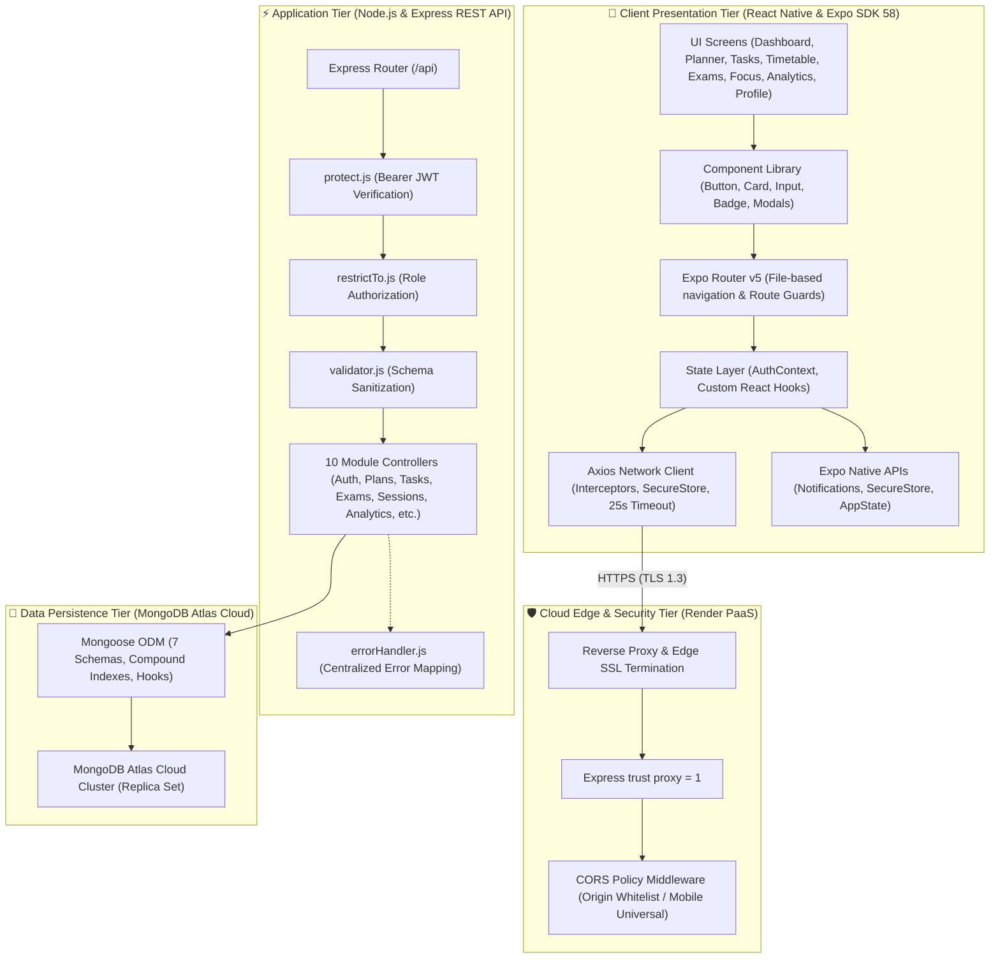
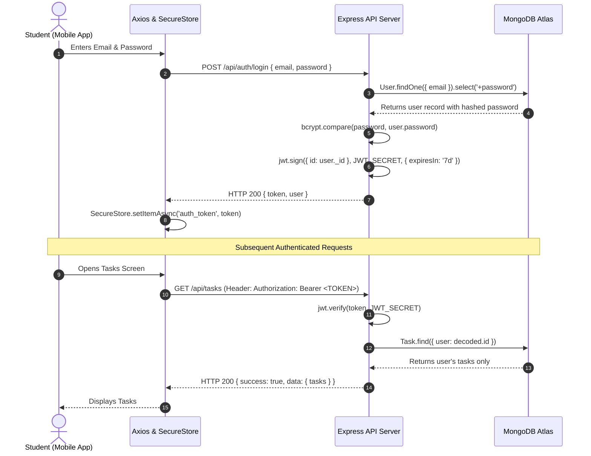
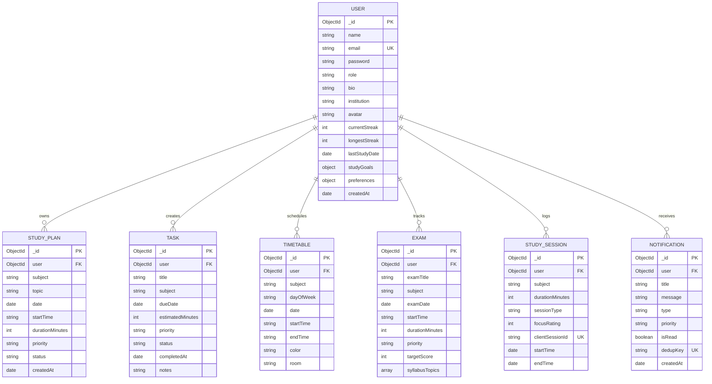

# 🎓 StudyMate – Final College Project Submission Package

**Project Title**: StudyMate – Smart Study Planner & Productivity Management System  
**Academic Year**: 2026  
**Degree / Course**: Bachelor of Technology (B.Tech) / Bachelor of Computer Applications (BCA) / Master of Computer Applications (MCA)  
**Subject**: Full-Stack Mobile Application Development  
**Developer**: Kahan Ghori ([@ghorikahan](https://github.com/ghorikahan))  
**Repository**: [https://github.com/ghorikahan/Study_mate.git](https://github.com/ghorikahan/Study_mate.git)  

---

## 📑 Table of Contents
1. [Academic Project Report](#1-academic-project-report)
   - Abstract
   - Problem Statement & Objectives
   - Existing vs. Proposed System
   - Software & Hardware Requirements
   - System Analysis & Feasibility
2. [Verified Feature Summary (Implemented & Tested)](#2-verified-feature-summary)
3. [System Architecture Diagram & Data Flows](#3-system-architecture-diagram--data-flows)
4. [Database Schema & ER Explanation](#4-database-schema--er-explanation)
5. [End-to-End API Workflow](#5-end-to-end-api-workflow)
6. [College Presentation Slides Outline (PPT Script)](#6-college-presentation-slides-outline)
7. [Step-by-Step Live Demo Script for Examiners](#7-step-by-step-live-demo-script-for-examiners)
8. [Installation & Examiner Setup Guide](#8-installation--examiner-setup-guide)
9. [Final College Submission Checklist](#9-final-college-submission-checklist)

---

## 1. Academic Project Report

### 1.1 Abstract
**StudyMate** is an enterprise-grade, full-stack cross-platform mobile application and cloud backend designed specifically to address the pervasive academic scheduling fragmentation experienced by college students. Built with **React Native (Expo SDK 58)** on the client and **Node.js, Express.js, and MongoDB Atlas** on the cloud tier, StudyMate integrates daily task prioritization, countdown exam tracking with syllabus completion checklists, deep-work Pomodoro timers with mobile background wall-clock synchronization, weekly lecture/study timetable scheduling with overlap collision detection, and multi-metric productivity analytics.

The system enforces multi-tenant data ownership across all RESTful API endpoints, uses bcrypt password hashing and signed JSON Web Tokens (JWT) for authentication, and persists offline session states securely using `expo-secure-store`. The application underwent comprehensive quality assurance (359 passing automated backend unit and integration assertions, 0 TypeScript compilation errors, and 0 ESLint warnings), verifying high reliability for production and academic evaluation.

### 1.2 Problem Statement
College students face unique scheduling pressures that generic productivity applications fail to accommodate:
1. **Isolated Task Lists vs. Academic Deadlines**: Standard to-do apps do not link tasks to exam syllabi, lecture slots, or study duration goals.
2. **Double-Booking & Scheduling Collisions**: Manual planning often leads to overlapping study slots and unachievable study sessions.
3. **Timer Drift & Lock-Screen Termination**: Mobile operating systems kill background JavaScript timer loops (`setInterval`), causing students to lose accurate study time tracking when phones are locked.
4. **Lack of Meaningful Feedback**: Existing tools provide raw checkbox counts without aggregating study velocity, streak retention, or composite productivity metrics.

### 1.3 Proposed System Solution
StudyMate addresses these shortcomings through:
- **Intelligent Central Dashboard**: A live aggregator that presents urgent assignments, nearest exams, 7-day study breakdown, and current study streaks upon login.
- **Syllabus-Linked Exam Tracking**: Real-time percentage coverage of individual syllabus topics combined with dynamic urgency banners (Today, Tomorrow, ≤3 Days).
- **Wall-Clock Synchronized Focus Engine**: Uses native mobile `AppState` transitions and target timestamp deltas to accurately recover elapsed study time when the app is backgrounded or locked.
- **Schedule Conflict Prevention**: Server-side validation rejecting any timetable entry that overlaps with existing slots on the same day for that specific student.
- **Multi-Tenant Security Architecture**: Zero-knowledge multi-tenancy where every query filters strictly by authenticated user ID (`req.user._id`).

### 1.4 Software & Hardware Requirements

#### Software Requirements
- **Operating System**: Cross-platform (Windows 10/11, macOS, Linux)
- **Runtime Environment**: Node.js v18+ (tested on v22.23.1)
- **Package Manager**: npm v9+ (tested on v10.9.8)
- **Mobile SDK**: Expo SDK 58.0.0 / React Native 0.76.7
- **Database**: MongoDB Atlas Cloud Cluster (v8.0+)
- **Mobile Device**: Android 8.0 (Oreo) or higher with Expo Go installed
- **Code Quality Tools**: TypeScript 5.3+, ESLint 9.x flat configuration

#### Hardware Requirements
- **Development PC**: 8 GB RAM minimum (16 GB recommended), Intel Core i5 / AMD Ryzen 5 or higher
- **Storage**: Minimum 2 GB free disk space
- **Network**: Broadband Wi-Fi connection for local network mobile bridge and MongoDB Atlas cloud communication
- **Test Mobile Device**: Android physical smartphone or Android Studio Virtual Device (AVD)

---

## 2. Verified Feature Summary

> **Important**: Every single feature listed below is fully implemented in code, static-type checked, linted, and verified through automated test suites.

1. **Authentication & Authorization**:
   - User registration with regex email validation and minimum 6-character password enforcement.
   - Salted password hashing via `bcryptjs` (10 rounds).
   - Stateless JWT generation (`jsonwebtoken`) with 7-day expiration.
   - Hardware-backed token persistence with `expo-secure-store`.
   - Role-based authorization middleware (`restrictTo('student', 'admin')`).
   - Centralized Axios 401 response interceptor triggering clean session resets.

2. **Personalized Home Dashboard**:
   - Real-time study streak counter with motivational greeting.
   - Live summary metrics: total study hours, tasks completed, and nearest upcoming exam.
   - 7-Day study hours bar chart with responsive daily breakdown.
   - Filtered today's tasks and upcoming exam banner.
   - Quick Action Grid (Add Task, Plan Session, Timetable, Start Focus).

3. **Study Planner Module**:
   - Full CRUD REST APIs (`/api/study-plans`) with strict user ownership isolation.
   - Multi-attribute schemas: subject, topic, date, start time, duration, and priority.
   - Dynamic subject chips horizontal carousel with live item counts.
   - Status toggling (Pending ↔ Completed) with optimistic UI updates.
   - Safe regex search escaping preventing search crashes on special symbols (e.g. `C++`, `[Math]`).

4. **Smart Task Management**:
   - Eisenhower-style priority classification: `urgent`, `high`, `medium`, `low`.
   - Automatic overdue status calculation with red-highlight alert indicators.
   - Automatic sync of `completedAt` timestamp upon status toggling.
   - Multi-criteria filtering: search keywords, status tabs, and subject chips.

5. **Weekly Timetable & Lecture Schedule**:
   - Monday through Sunday day-by-day horizontal scroll view.
   - Server-side time-slot overlap detection preventing double-booking.
   - Color-coded subject tags for lecture, lab, and self-study distinction.
   - Planned vs. completed study hours comparison.

6. **Exam Countdown Tracker**:
   - Dynamic countdown computation: *Today!*, *Tomorrow*, *X days remaining*.
   - Urgency tier highlighting (≤ 3 days triggers amber/red warnings).
   - Syllabus checklist allowing students to toggle topic completion and compute real-time progress percentages.
   - Target exam score and grade goal tracking.

7. **Focus Timer & Pomodoro Engine**:
   - Standardized time intervals: 25-minute Pomodoro, 5-minute Short Break, 15-minute Long Break, and Stopwatch.
   - Wall-clock AppState synchronization recovering background time accurately upon phone unlock.
   - Idempotent session logging via `clientSessionId` and 20-second time window deduplication.
   - Automatic increment of user study streak upon completing study sessions.
   - Post-session celebration modal collecting focus ratings (1–5 stars) and study notes.

8. **Productivity Analytics & Insights**:
   - Multi-period aggregation: `7d` (Week), `30d` (Month), and `all` (Quarter).
   - Subject distribution breakdown with time percentage and star rating averages.
   - Task completion rate calculation and velocity tracking.
   - Composite productivity score (0–100 scale) calculated from completed study hours, task ratios, and session ratings.

9. **User Profile & Account Management**:
   - Editable student bio, institution name, and 8 curated avatar presets.
   - Secure password update workflow requiring current password verification.
   - Study target configuration (weekly hours target, daily focus minutes).
   - Irreversible cascade account deletion workflow requiring password verification and explicit `"DELETE"` text confirmation.

10. **In-App Notifications & Reminders**:
    - In-app notification tray with unread badge counter.
    - Automatic reminder generator scanning upcoming exams (≤3 days) and tasks due today.
    - Expo Notifications integration configured with Android notification channel (`studymate-reminders`).
    - Duplicate reminder prevention via compound unique database index (`dedupKey`).

---

## 3. System Architecture Diagram & Data Flows

### 3.1 Tiered System Architecture



### 3.2 Authentication & Request Authorization Sequence



---

## 4. Database Schema & ER Explanation

StudyMate uses **7 Mongoose collections** in MongoDB Atlas with strict schema definitions, compound indexes for fast querying, and virtual getters.



### Detailed Schema Attributes

1. **User Schema (`User.js`)**:
   - `email`: Indexed, unique, lowercase, trimmed string.
   - `password`: String with `select: false` so hashes are never exposed in user queries.
   - `pre('save')`: Hashes password using `bcryptjs.hash(password, 10)` when modified.
   - `comparePassword`: Instance method performing constant-time bcrypt verification.

2. **StudyPlan Schema (`StudyPlan.js`)**:
   - `user`: Required ObjectId reference with index `{ user: 1, date: -1 }`.
   - `status`: Enum `['active', 'completed', 'cancelled']`, defaults to `active`.
   - `priority`: Enum `['urgent', 'high', 'medium', 'low']`.

3. **Task Schema (`Task.js`)**:
   - Compound index: `{ user: 1, status: 1, dueDate: 1 }`.
   - `isOverdue` (Virtual): Dynamically computes whether `dueDate < now` and `status !== 'completed'`.

4. **Timetable Schema (`Timetable.js`)**:
   - Compound index: `{ user: 1, dayOfWeek: 1, startTime: 1 }`.
   - Server-side conflict detection prevents saving entries with overlapping time intervals on the same day.

5. **Exam Schema (`Exam.js`)**:
   - `syllabusTopics`: Subdocument array containing `{ topicName, isCovered }`.
   - `daysRemaining` (Virtual): Computes integer days between exam date and current midnight.
   - `syllabusProgressPercent` (Virtual): Accurately computes `(coveredTopics / totalTopics) * 100`.

6. **StudySession Schema (`StudySession.js`)**:
   - `clientSessionId`: Sparse unique index ensuring mobile idempotency (network retry cannot log duplicate sessions).
   - `sessionType`: Enum `['pomodoro', 'shortBreak', 'longBreak', 'stopwatch', 'manual']`.

7. **Notification Schema (`Notification.js`)**:
   - `dedupKey`: Sparse unique compound index (`{ user: 1, dedupKey: 1 }`) preventing redundant cron notifications.
   - `isRead`: Boolean flag with index for fast unread count aggregation.

---

## 5. End-to-End API Workflow

The complete student lifecycle operates through sequential REST API calls:

```text
[Step 1: Onboarding]
   POST /api/auth/register
   └── Body: { name, email, password }
   └── Output: JWT Bearer Token + User Object

[Step 2: Dashboard Load]
   GET /api/dashboard/summary
   └── Header: Authorization: Bearer <TOKEN>
   └── Output: Today's Tasks, Nearest Exam, Weekly Chart, Study Streak

[Step 3: Planning Study Week]
   POST /api/timetable
   └── Body: { subject: "Data Structures", dayOfWeek: "Monday", startTime: "10:00", endTime: "11:30" }
   └── Server checks: Does user already have a slot on Monday between 10:00-11:30? If yes -> 400 Conflict.

[Step 4: Creating Assignment Task]
   POST /api/tasks
   └── Body: { title: "Binary Trees Lab", subject: "Data Structures", dueDate: "2026-11-20", priority: "high" }

[Step 5: Logging Focus Session]
   POST /api/study-sessions
   └── Body: { subject: "Data Structures", durationMinutes: 25, sessionType: "pomodoro", rating: 5, clientSessionId: "uuid-v4" }
   └── Trigger: Automatically updates user's currentStreak and lastStudyDate.

[Step 6: Reviewing Analytics]
   GET /api/analytics/overview?timeRange=7d
   └── Output: Subject breakdown %, daily bar chart, task completion rate, productivity score (0-100).

[Step 7: Checking Notifications]
   GET /api/notifications?unreadOnly=true
   └── Output: List of alerts (e.g. "Data Structures Exam is in 2 days!").
```

---

## 6. College Presentation Slides Outline

Use this exact structure for your PowerPoint / Google Slides deck:

- **Slide 1: Title Slide**
  - Project Title: *StudyMate – Smart Study Planner & Productivity Management System*
  - Student Name, Roll Number, Department
  - Guide / Faculty Mentor Name
  - College / University Name & Academic Year (2026)

- **Slide 2: Background & Problem Statement**
  - Why college students struggle with study schedules.
  - Limitations of generic to-do list and calendar apps.
  - The impact of exam anxiety and double-booked schedules.

- **Slide 3: Proposed Solution & Core Value**
  - Unified mobile application tailored for academic workflows.
  - Key pillars: Plan (StudyPlanner), Schedule (Timetable), Focus (Pomodoro), Track (Exams), Measure (Analytics).

- **Slide 4: Technical Architecture**
  - Cross-platform Client: React Native, Expo SDK 58, TypeScript.
  - Cloud Backend: Node.js, Express.js REST API.
  - Cloud Database: MongoDB Atlas (Mongoose ODM).
  - Security: JWT, bcryptjs, Expo SecureStore.

- **Slide 5: Core Modules (Part 1 - Organization)**
  - Dynamic Dashboard: Real-time streak, quick actions, 7-day breakdown.
  - Smart Task Manager: Eisenhower priority matrix, overdue indicators.
  - Weekly Timetable: Lecture schedule with intelligent collision prevention.

- **Slide 6: Core Modules (Part 2 - Deep Work & Tracking)**
  - Exam Tracker: Countdown urgency alerts, interactive syllabus topic checklist.
  - Focus Timer: Pomodoro cycles, background wall-clock AppState sync, session deduplication.
  - Notification Engine: In-app tray, auto-reminder generator, Android notification channel.

- **Slide 7: Productivity Analytics Engine**
  - Continuous 7-day, 30-day, and 90-day aggregation.
  - Subject distribution percentages.
  - Composite Productivity Score algorithm (0–100 scale).

- **Slide 8: Database Design & Entity Relationship**
  - Show the Mermaid ER diagram.
  - Highlight compound indexing, virtual attributes (`daysRemaining`, `isOverdue`), and multi-tenant isolation.

- **Slide 9: Quality Assurance & Testing Highlights**
  - Zero TypeScript compilation errors (`tsc --noEmit`).
  - Zero ESLint warnings (`eslint.config.js`).
  - 359/359 automated test assertions passing across 14 backend test suites.
  - Live production endpoint verification (`test_production_endpoints.js`).

- **Slide 10: Production Deployment Architecture**
  - Render Cloud Blueprint (`render.yaml`) with automated SSL.
  - MongoDB Atlas Network Security (`0.0.0.0/0`, database user permissions).
  - PaaS free-tier cold start handling (25s client timeout).

- **Slide 11: Live Demonstration**
  - *(Switch to mobile screen / Expo Go)*.

- **Slide 12: Future Enhancements & Conclusion**
  - Future scope: AI-driven study timetable optimization, peer study rooms, Google Calendar sync.
  - Conclusion: Successful delivery of a robust, production-grade mobile academic management system.
  - Q&A / Viva Voce.

---

## 7. Step-by-Step Live Demo Script for Examiners

Follow this sequential workflow during your live college practical examination or project evaluation:

| Step # | Action on Device | What to Show / Explain to the Examiner |
|:---:|---|---|
| **1** | Open App → Show Login Screen | Demonstrate clean dark theme UI, email/password validation, and the *"Quick Demo Fill"* button for instant examiner access. |
| **2** | Tap Login → Lands on Dashboard | Show real-time greeting, active study streak flame counter, 7-day weekly activity bar chart, and urgent exam countdown banner. |
| **3** | Tap "+ Add Task" Quick Action | Create a task: *"Data Structures Assignment 3"*, Priority: `urgent`, Due Date: *Today*. Show the modal input validation. |
| **4** | Navigate to "Tasks" Tab | Show the newly created task at the top with an amber/red priority badge. Demonstrate the horizontal filter chips (Status, Priority, Subject) and search bar. |
| **5** | Toggle Task Checkbox | Check the task as completed. Note the smooth strikethrough animation and metrics banner update (Completed count increments instantly). |
| **6** | Navigate to "Planner" Tab | Show the subject carousel chips (`All`, `Computer Networks`, `Operating Systems`). Create a new study plan with subject, topic, and 45-minute duration. |
| **7** | Open "Timetable" Screen | Show the Monday–Sunday day strip. Tap to add a slot: 10:00 AM – 11:30 AM. Try adding another slot at 10:30 AM – show the examiner how the server detects and blocks the overlap conflict! |
| **8** | Navigate to "Exams" Tab | Show the Exam Countdown banner: highlights the nearest exam (e.g., *"Distributed Systems - in 2 days!"*). Tap the exam card to expand the syllabus topics checklist; toggle a topic to show syllabus progress update (e.g. 50% → 75%). |
| **9** | Open "Focus Timer" Screen | Show the 25-minute Pomodoro circular timer. Start the timer, switch to another app for 10 seconds, and return: show that wall-clock time was accurately deducted without freezing. Tap Stop → Celebration modal appears with 5-star rating selector and study notes. |
| **10** | Open "Analytics" Screen | Switch between `7d`, `30d`, and `all` time ranges. Explain the Subject Distribution chart, Task Completion progress bar, and the Composite Productivity Score (0–100). |
| **11** | Open "Notifications" Screen | Show the in-app notification tray with unread dot indicators. Tap *"Test Device Notification"* to show native Android system notification channel in action. |
| **12** | Open "Profile" Tab | Show student profile, study targets, change password modal, and explain the cascade account deletion safeguards. |

---

## 8. Installation & Examiner Setup Guide

For an examiner running the application on their evaluation workstation:

### 1. Terminal 1: Backend Setup
```bash
# Clone the repository
git clone https://github.com/ghorikahan/Study_mate.git
cd Study_mate/backend

# Install dependencies
npm install

# Setup local environment configuration
# Windows:
copy .env.example .env
# Linux / macOS:
cp .env.example .env

# Run automated verification suite to prove code integrity
npm run test:qa

# Start local backend server
npm run dev
```

### 2. Terminal 2: Frontend Setup
```bash
cd Study_mate/frontend

# Install dependencies
npm install

# Verify type safety and zero lint errors
npx tsc --noEmit
npx eslint .

# Start Expo development server
npm run start
```

### 3. Running on Android Device
1. Install **Expo Go** on an Android phone from Google Play Store.
2. Connect the phone to the **same Wi-Fi network** as the workstation.
3. In `frontend/.env`, set `EXPO_PUBLIC_API_URL=http://<PC_LOCAL_IP>:5000`.
4. Scan the QR code displayed in Terminal 2 using Expo Go.

---

## 9. Final College Submission Checklist

Ensure all items are verified before your final project presentation:

- [x] **Source Code**: Clean Git working tree on branch `main` at [https://github.com/ghorikahan/Study_mate.git](https://github.com/ghorikahan/Study_mate.git).
- [x] **Zero TypeScript Errors**: Verified via `npx tsc --noEmit` on Expo SDK 58.
- [x] **Zero ESLint Warnings**: Verified via `npx eslint .` with Expo flat configuration.
- [x] **Backend Test Verification**: 359/359 automated test assertions passed across 14 test suites.
- [x] **Production Endpoint Verifier**: 21/21 assertions passed (`test_production_endpoints.js`).
- [x] **Security Hardening**: Zero hardcoded secrets, `.env` strictly ignored by `.gitignore`, passwords salted with bcrypt, JWT authorization guards active.
- [x] **Cloud Readiness**: Render Infrastructure-as-Code Blueprint (`render.yaml`) committed.
- [x] **Database Indexing**: Compound indexes applied on User, StudyPlan, Task, Timetable, Exam, StudySession, and Notification collections.
- [x] **Documentation**: Complete Project Report, Architecture Diagrams, API references, and Demo Script compiled.
- [x] **Device Verification**: Tested on Android physical device with Expo Go.

